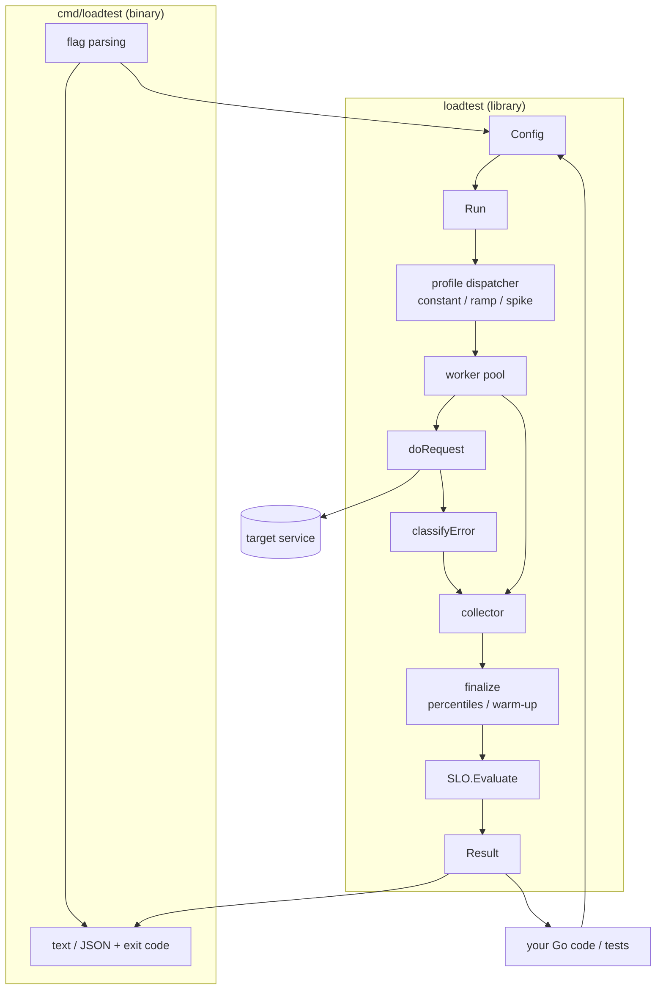

# loadtester

A lightweight HTTP load tester for Go, built for **surfacing common
system-design failure modes** — throughput saturation, tail-latency
degradation, backpressure under spikes, and SLO violations. Zero third-party
dependencies (standard library only). Use it two ways:

- **As a binary** — a single static executable you drop into any project or CI pipeline.
- **As a library** — import the `loadtest` package and run tests programmatically, asserting on the results.

<!-- START doctoc generated TOC please keep comment here to allow auto update -->
<!-- DON'T EDIT THIS SECTION, INSTEAD RE-RUN doctoc TO UPDATE -->
<!-- END doctoc generated TOC please keep comment here to allow auto update -->

## System-design failure modes covered

| Failure mode | How this tool surfaces it |
|--------------|---------------------------|
| **Throughput saturation / knee point** | `ramp` profile scales workers over time; per-interval metrics show where RPS plateaus and latency climbs |
| **Tail-latency degradation** | p95 / p99 / **p99.9** + standard deviation |
| **Spike / burst handling & backpressure** | `spike` profile fires periodic worker bursts over a baseline |
| **Rate limiting & throttling** | status-code breakdown isolates `429` / `503` responses |
| **Backend down vs. saturated** | error classification splits `conn_refused` from `timeout` |
| **Connection exhaustion** | `conn_exhausted` error class (socket/fd limits) |
| **DNS / TLS problems** | dedicated `dns` and `tls` error classes |
| **Cold-start effects** | `-warmup` window excludes startup requests from steady-state stats |
| **SLO regression (CI gating)** | `-slo-*` thresholds produce pass/fail + non-zero exit code |
| **Sustained soak / stability** | long `-d` duration runs with live interval metrics |

## Features

- Concurrency control (worker pool), fixed request count **or** time-bounded runs
- **Load profiles**: `constant`, `ramp` (stepped scale-up), `spike` (periodic bursts)
- Optional global rate limiting (req/s)
- Any HTTP method, custom headers, request body (inline or from file)
- Latency percentiles (p50/p90/p95/p99/**p99.9**), **stddev**, throughput, error rate
- **Error classification**: timeout, conn_refused, conn_reset, dns, tls, conn_exhausted, canceled, other
- **Warm-up filtering** to exclude cold-start effects
- **Live interval metrics** during the run
- **SLO assertions** with pass/fail and CI-friendly exit codes
- **JSON output** for dashboards and pipelines
- Graceful Ctrl-C cancellation; cross-compiles to Linux/macOS/Windows on amd64/arm64

## Architecture

A reusable **library** (`loadtest/`) does all the work; a thin **CLI**
(`cmd/loadtest/`) just parses flags and delegates. See
[docs/architecture.md](docs/architecture.md) for request-flow, profile-timeline,
and concurrency diagrams.



## Install / Build

```sh
make build     # build host binary into ./build/loadtest
make install   # install into $GOBIN
make release   # cross-compile release binaries for all platforms
```

Requires Go 1.18+.

## Binary usage

```sh
# Basic: 1000 requests with 50 concurrent workers
loadtest -n 1000 -c 50 https://example.com

# Find the saturation knee: ramp 1 -> 200 workers over 60s, live metrics
loadtest -profile ramp -d 60s -ramp-start 1 -ramp-end 200 -interval 5s https://example.com

# Spike test: 10 baseline workers, bursts of 200 every 15s for 2s
loadtest -profile spike -d 90s -c 10 -spike-c 200 -spike-every 15s -spike-for 2s https://example.com

# CI gate with SLOs (exit 1 if violated), excluding 5s cold start
loadtest -d 30s -c 100 -warmup 5s -slo-p99 250ms -slo-error-rate 0.01 -slo-min-rps 500 https://example.com

# JSON output for dashboards
loadtest -n 2000 -c 100 -json https://example.com

# POST with headers and a JSON body
loadtest -m POST -H "Content-Type: application/json" -body '{"a":1}' https://api.example.com/x
```

### Flags

| Flag                 | Default    | Description                                       |
|----------------------|------------|---------------------------------------------------|
| `-n`                 | `0`        | Total requests (0 = use `-d`)                     |
| `-c`                 | `10`       | Concurrent workers (baseline for spike)           |
| `-d`                 | `0`        | Duration (e.g. `30s`, `2m`), used when `-n` is 0  |
| `-rate`              | `0`        | Max requests/sec across all workers (0 = unlimited) |
| `-m`                 | `GET`      | HTTP method                                       |
| `-H`                 |            | Header `"Key: Value"` (repeatable)                |
| `-body`              |            | Request body                                      |
| `-body-file`         |            | Read request body from a file                     |
| `-timeout`           | `30s`      | Per-request timeout                               |
| `-disable-keepalive` | `false`    | Disable HTTP keep-alive                           |
| `-insecure`          | `false`    | Skip TLS certificate verification                 |
| `-profile`           | `constant` | Load profile: `constant` \| `ramp` \| `spike`     |
| `-ramp-start`        | `1`        | Ramp: starting worker count                       |
| `-ramp-end`          | `-c`       | Ramp: ending worker count                         |
| `-spike-c`           | `5x -c`    | Spike: worker count during a burst                |
| `-spike-every`       | `10s`      | Spike: period between bursts                      |
| `-spike-for`         | `1s`       | Spike: burst length                               |
| `-warmup`            | `0`        | Exclude requests in this initial window from stats |
| `-interval`          | `0`        | Print live metrics every interval (e.g. `1s`)     |
| `-json`              | `false`    | Output the final result as JSON                   |
| `-slo-p99`           | `0`        | SLO: fail if p99 latency exceeds this             |
| `-slo-p95`           | `0`        | SLO: fail if p95 latency exceeds this             |
| `-slo-error-rate`    | `0`        | SLO: fail if error rate exceeds this (0-1)        |
| `-slo-min-rps`       | `0`        | SLO: fail if throughput falls below this          |

**Exit codes:** `0` = ok, `1` = SLO failed or all requests failed, `2` = usage/config error. This makes it a drop-in CI gate.

## Library usage

```go
package main

import (
	"context"
	"fmt"
	"time"

	"github.com/eshdiar/loadtester/loadtest"
)

func main() {
	cfg := &loadtest.Config{
		URL:         "https://example.com",
		Duration:    60 * time.Second,
		Profile:     loadtest.ProfileRamp,
		RampStart:   1,
		RampEnd:     200,
		Interval:    5 * time.Second,
		WarmUp:      5 * time.Second,
		SLO: &loadtest.SLO{
			MaxP99:       250 * time.Millisecond,
			MaxErrorRate: 0.01,
			MinRPS:       500,
		},
		OnInterval: func(s loadtest.IntervalStats) {
			fmt.Printf("%s: %.0f req/s, p99 %s\n", s.Elapsed, s.RPS, s.P99)
		},
	}

	result, err := loadtest.Run(context.Background(), cfg)
	if err != nil {
		panic(err)
	}

	fmt.Println(result.String())
	if result.SLO != nil && !result.SLO.Passed {
		fmt.Println("SLO violated:", result.SLO.Failures)
	}
}
```

### Asserting in your own tests

Because `Run` returns a structured `Result`, you can gate your service's
performance inside a normal Go test:

```go
func TestCheckoutLatency(t *testing.T) {
	cfg := &loadtest.Config{URL: testServerURL, Requests: 2000, Concurrency: 100}
	res, err := loadtest.Run(context.Background(), cfg)
	if err != nil {
		t.Fatal(err)
	}
	if res.P99 > 50*time.Millisecond {
		t.Errorf("p99 regressed: %s", res.P99)
	}
	if res.Errors[loadtest.ErrTimeout] > 0 {
		t.Errorf("%d requests timed out — backend saturated?", res.Errors[loadtest.ErrTimeout])
	}
}
```

## JSON output shape

```json
{
  "total_requests": 300,
  "success_count": 282,
  "error_count": 18,
  "warmup_excluded": 0,
  "error_rate": 0.06,
  "rps": 1866.87,
  "elapsed_ms": 160.69,
  "latency_ms": { "min": 0.1, "mean": 9.9, "stddev": 5.6, "max": 20.7,
                  "p50": 10.0, "p90": 17.4, "p95": 19.3, "p99": 20.0, "p999": 20.7 },
  "status_codes": { "200": 282, "503": 18 },
  "errors": { "timeout": 0 },
  "slo": { "passed": false, "failures": ["p99 20.005ms exceeds max 5ms"] }
}
```

## Interpreting results

| Symptom in the output | Likely meaning | What to try next |
|-----------------------|----------------|------------------|
| High **p99 / p99.9** but low p50 | Tail latency — a minority of requests are slow (GC pauses, lock contention, cold caches) | Increase warm-up; profile the service; check for head-of-line blocking |
| Large **stddev** relative to mean | Inconsistent response times | Look for contended resources or noisy neighbors |
| RPS stops rising while latency climbs (in `-interval` output during a `ramp`) | **Saturation knee** reached — the service's max sustainable throughput | Use the worker count just before the knee as the safe operating point |
| Many `timeout` errors | Backend is overloaded or a dependency is slow | Lower concurrency; check downstream timeouts and pool sizes |
| Many `conn_refused` errors | Nothing is listening / service crashed / not enough listeners | Verify the service is up and the port/backlog is correct |
| `conn_reset` errors | Peer closed connections mid-flight | Check keep-alive limits, LB idle timeouts, server max-connections |
| `conn_exhausted` errors | Client ran out of sockets/file descriptors | Raise `ulimit -n`; reuse connections (avoid `-disable-keepalive`) |
| `429` / `503` in status codes | Rate limiting / shedding | Expected under throttling; compare against your rate-limit config |
| Throughput far below `-rate` | Client can't keep up, or server is the bottleneck | Raise `-c`; check if latency × concurrency explains the ceiling |

Rule of thumb: **max sustainable RPS ≈ concurrency ÷ average latency**. If you
want 1000 RPS at 50 ms average latency, you need roughly 50 concurrent workers
(`1000 × 0.05`). The `ramp` profile finds this empirically.

## Project layout

```
loadtester/
├── loadtest/                  # importable library (stdlib only)
│   ├── config.go              # Config, load profiles, SLO, defaults, validation
│   ├── runner.go              # engine: constant/ramp/spike profiles, interval reporting
│   ├── stats.go               # Result aggregation, percentiles, warm-up, SLO eval
│   ├── errors.go              # transport error classification
│   ├── json.go                # JSON output
│   ├── runner_test.go         # engine + integration tests
│   ├── stats_test.go          # percentile/stddev/config/JSON unit tests
│   └── doc_example_test.go    # runnable Example (godoc)
├── cmd/loadtest/              # CLI that wraps the library
│   ├── main.go
│   └── main_test.go           # CLI build-and-run integration tests
├── docs/
│   └── architecture.md        # diagrams: component, request flow, profiles
├── git_config_test.go         # verifies local git identity/signing config
├── Makefile
└── go.mod
```

## Development

```sh
make test   # run all tests (library + CLI integration + git config)
make vet    # go vet
make fmt    # gofmt
```

Run a focused package:

```sh
go test ./loadtest/        # library unit/integration tests
go test ./cmd/loadtest/    # CLI integration tests (builds the binary)
go test .                  # git config test
```
