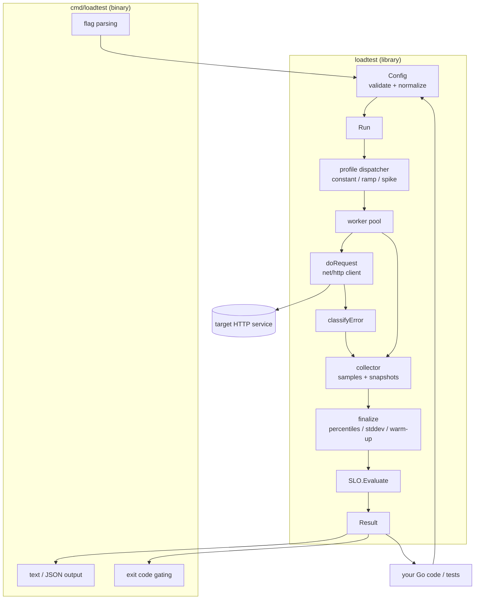
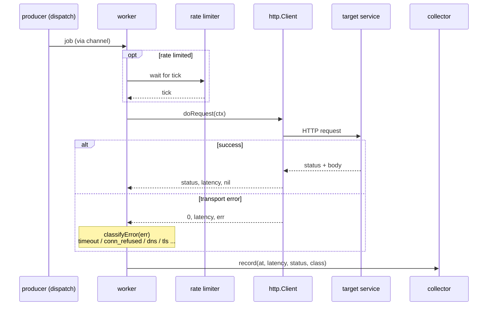

# Architecture

This document describes how `loadtester` is structured and how a load test
flows through the system.

<!-- START doctoc generated TOC please keep comment here to allow auto update -->
<!-- DON'T EDIT THIS SECTION, INSTEAD RE-RUN doctoc TO UPDATE -->
<!-- END doctoc generated TOC please keep comment here to allow auto update -->

## Overview

`loadtester` is split into a reusable **library** (`loadtest/`) and a thin
**CLI** (`cmd/loadtest/`) that only parses flags and delegates to the library.
Everything uses the Go standard library — there are no third-party
dependencies.



The CLI is optional: any Go program can import `loadtest`, build a `Config`,
call `Run`, and inspect the returned `Result` — this is how performance
assertions are written inside normal `go test` suites.

## Request flow

A single request's lifecycle, from a worker pulling a job to the sample being
recorded:



Latency is measured around `client.Do` only (not including the time a job
waits in the channel or behind the rate limiter), so it reflects the service's
response time rather than client-side queueing.

## Load profiles over time

The three profiles differ only in how many workers are active at each moment.
`constant` holds a fixed pool; `ramp` adds workers on a timer; `spike` keeps a
baseline pool and launches short-lived bursts.

```mermaid
gantt
    title Active workers over time (conceptual)
    dateFormat X
    axisFormat %s

    section constant
    N workers (flat)        :0, 10

    section ramp
    start -> end (stepped)  :0, 10

    section spike
    baseline                :0, 10
    burst 1                 :2, 1
    burst 2                 :5, 1
    burst 3                 :8, 1
```



- **constant** — steady N workers. Baseline latency/throughput; also used for
  soak tests via a long duration.
- **ramp** — workers scale linearly from `RampStart` to `RampEnd` across the
  run. Combined with `-interval`, the point where RPS stops rising while
  latency climbs is the **saturation knee**.
- **spike** — a baseline of `Concurrency` workers plus bursts of
  `SpikeConcurrency` workers lasting `SpikeFor`, every `SpikeEvery`. Tests
  backpressure and recovery.

## Concurrency model

```mermaid
graph LR
    subgraph producer
        D[dispatch goroutine]
    end
    subgraph workers
        W1[worker 1]
        W2[worker 2]
        Wn[worker N]
    end
    subgraph reporting
        T[interval ticker goroutine]
    end
    JOBS{{jobs channel}}
    COLL[collector<br/>mutex-guarded]

    D -->|struct{}| JOBS
    JOBS --> W1
    JOBS --> W2
    JOBS --> Wn
    W1 --> COLL
    W2 --> COLL
    Wn --> COLL
    T -->|snapshot| COLL
```

- One **dispatch** goroutine feeds an unbuffered `jobs` channel. For
  request-bounded runs it enqueues exactly `Requests` jobs then closes the
  channel; for duration-bounded runs it feeds until the context expires.
- **Workers** pull jobs, optionally wait on the shared rate limiter, perform
  the request, classify any error, and record a sample.
- An optional **interval ticker** goroutine calls `collector.snapshot` to emit
  live metrics without disturbing the final aggregation.
- The **collector** serializes all reads/writes with a mutex. Samples retain a
  completion timestamp so warm-up filtering can be applied in `finalize`.

## Why these choices

- **Channel + worker pool** rather than one goroutine per request: bounds
  concurrency precisely (that is the variable under test) and avoids unbounded
  goroutine growth.
- **Retain samples, filter at the end**: warm-up exclusion and accurate
  percentiles need the full distribution; a streaming estimator would trade
  accuracy for memory we do not need at typical test sizes.
- **Error classification by type then message**: `errors.As` handles typed
  errors (`net.Error`, `net.DNSError`); string matching catches syscall-level
  conditions the standard library does not expose as distinct types on all
  platforms.
